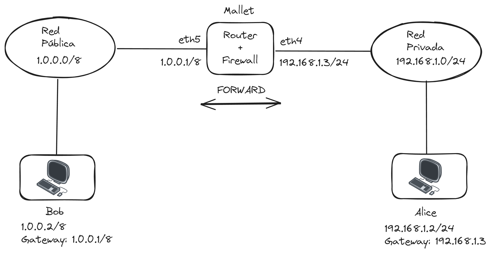

<div align="center">

# Laboratorio de seguridad de la información

**Prácticas de seguridad ofensiva y defensiva: laboratorio virtual aislado, reconocimiento con Nmap, hashing y cifrado, firma digital, *pentesting* web y diseño de un SGSI con MAGERIT.**


<sub>Garantía y Seguridad de la Información · Grado en Ingeniería Informática · Universidad de Valladolid · Curso 2023-2024</sub>

</div>

<p align="center">
  
  <br>
  <sub>Esquema de red de la práctica 3: <i>mallet</i> actúa como router y cortafuegos entre la red pública (<i>bob</i>) y la privada (<i>alice</i>).</sub>
</p>

## En pocas palabras

- **Reto**: aplicar seguridad de la información de punta a punta, desde atacar y analizar servicios hasta gestionar el riesgo de una organización.
- **Solución**: cinco prácticas sobre un laboratorio virtual propio (reconocimiento de red, criptografía, firma digital y *pentesting* de una aplicación web), más un proyecto de Sistema de Gestión de la Seguridad de la Información (SGSI) para una empresa ficticia.
- **Demuestra**: mentalidad ofensiva con método (reconocimiento → hipótesis → explotación), fundamentos criptográficos y gestión del riesgo con estándares reconocidos.

## Lo más destacado

- **Pentesting web razonado**: partiendo del reconocimiento de puertos con Nmap, se plantea una hipótesis sobre el endpoint de descarga de ficheros y se confirma descargando el código fuente PHP del *backend*.
- **Laboratorio aislado**: máquinas virtuales *alice*, *bob* y *mallet* en VirtualBox sobre una red NAT dedicada, con *mallet* como router y cortafuegos entre una red pública y otra privada.
- **Reconocimiento de red**: descubrimiento de equipos y puertos con Nmap (barridos ICMP y SYN) y análisis de servicios como `telnet` y `ssh`.
- **Criptografía aplicada**: propiedades de las funciones hash, `md5sum`/`sha*sum`, identificación de hashes y de las contraseñas de `/etc/shadow`; firma digital paso a paso (hash → cifrado con clave privada → verificación con clave pública) y análisis del certificado de un servidor web real.
- **Gestión del riesgo**: el proyecto SGSI usa MAGERIT v3 e ISO/IEC 27000, con plantillas de inventario de activos, matriz y análisis de riesgos.

## Competencias

| Área | Qué se aplicó |
|------|---------------|
| Seguridad ofensiva | Reconocimiento con Nmap, *pentesting* de aplicación web |
| Redes | Laboratorio virtual con red NAT, enrutamiento y cortafuegos, `tcpdump` |
| Criptografía | Funciones hash, RSA, firma digital, certificados digitales |
| Gobierno de la seguridad | SGSI, análisis de riesgos con MAGERIT v3, ISO/IEC 27000 |

## Contenido

| Práctica | Tema | Entrega |
|----------|------|---------|
| [Práctica 1](Practica1/) | Preparación del entorno virtual: *alice*, *bob* y *mallet* en VirtualBox sobre una red NAT propia, más un esquema en Packet Tracer | [p1_GarciaGonzalez.pdf](Practica1/p1_GarciaGonzalez.pdf) |
| [Práctica 2](Practica2/) | Análisis de servicios de red: descubrimiento de equipos y puertos con Nmap (ICMP, SYN) y servicios como `telnet` y `ssh` | [p2_GarciaGonzalez.pdf](Practica2/p2_GarciaGonzalez.pdf) |
| [Práctica 3](Practica3/) | Hashing, cifrado y certificados: funciones hash, `md5sum`/`sha*sum`, identificación de hashes y contraseñas de `/etc/shadow` | [p3_GarciaGonzalez.pdf](Practica3/p3_GarciaGonzalez.pdf) |
| [Práctica 4](Practica4/) | Certificados y firma digital: generación y validación de firmas, y análisis del certificado de un servidor web real | [parte 1](Practica4/p4_parte1_GarciaGonzalez.pdf), [parte 2](Practica4/p4_parte2_GarciaGonzalez.pdf) |
| [Práctica 5](Practica5/) | *Pentesting* en aplicativos web: reconocimiento con Nmap y explotación de una descarga de ficheros que permite leer el código fuente | [p5_GarciaGonzalez.pdf](Practica5/p5_GarciaGonzalez.pdf) |
| [Proyecto final](Proyecto_final/) | Enunciado y materiales para la primera versión de un SGSI para una empresa ficticia | — |

Las carpetas incluyen también los enunciados y la bibliografía de apoyo (capítulos de *Applied Information Security*, de Basin et al.). Herramientas citadas en la práctica 2: consulta sus [referencias](Practica2/links.txt).

## Estructura del repositorio

```text
GSI/
├── Practica1/        # Entorno virtual (+ practica1.pkt)
├── Practica2/        # Servicios de red (Nmap)
├── Practica3/        # Hashing y cifrado (+ diagrama de red)
├── Practica4/        # Certificados y firma digital (2 partes)
├── Practica5/        # Pentesting web
└── Proyecto_final/
    ├── 2023-2024-PSGSI-Enunciado.pdf
    ├── Materiales de trabajo/                     # MAGERIT, guías SGSI y de gestión de riesgos
    └── Plantillas para realizar los cálculos/      # Hojas de cálculo de análisis de riesgos
```

## Requisitos

- Un lector de PDF para los informes y enunciados
- Cisco Packet Tracer para `Practica1/practica1.pkt`
- Para reproducir las prácticas: VirtualBox, distribuciones Linux para las máquinas virtuales y Nmap

## Cómo reproducirlo

```bash
git clone https://github.com/JavivuG/GSI.git
cd GSI
```

Cada práctica se reproduce siguiendo su enunciado (`P*_GSI_2324*.pdf`) y el informe correspondiente, que recoge los comandos y las capturas.

## Estado y limitaciones

- El repositorio no contiene código ejecutable: las entregas son informes en PDF.
- Las imágenes de las máquinas virtuales no están en el repositorio (se excluyen en el `.gitignore`).
- El repositorio contiene el enunciado y los materiales del proyecto SGSI, pero no un informe de entrega.

## Autoría

Javier García González.

---

<div align="center"><sub>Parte de <a href="https://github.com/JavivuG/UVa-Projects">UVa-Projects</a> · Javier García González</sub></div>
